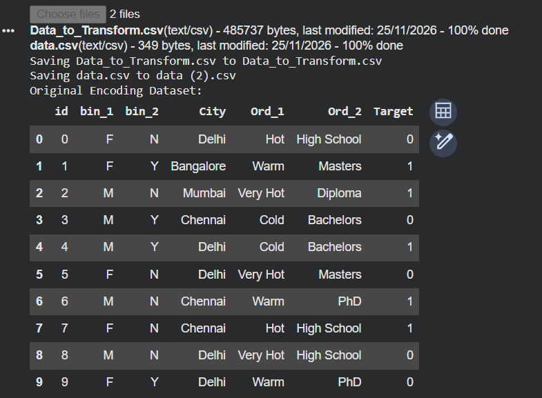
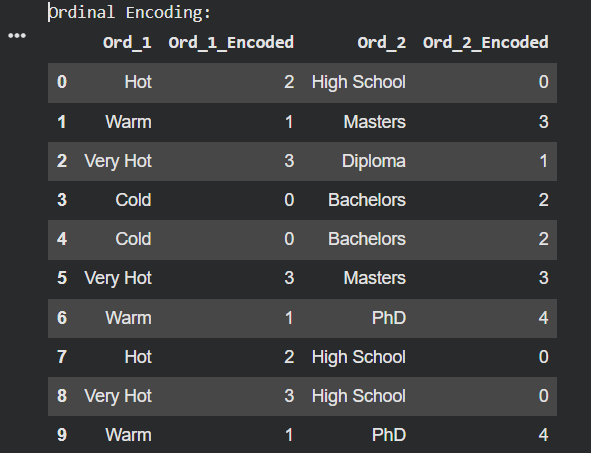
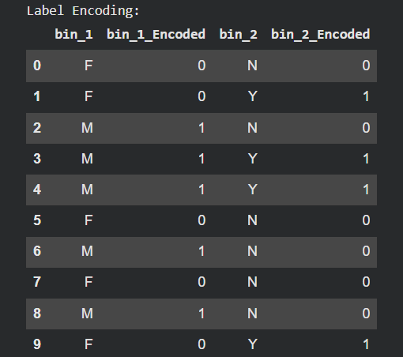
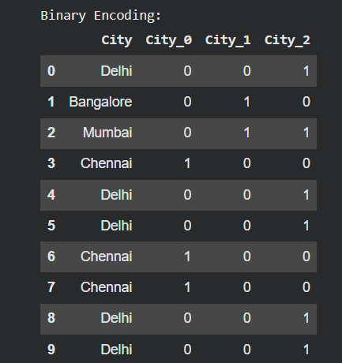
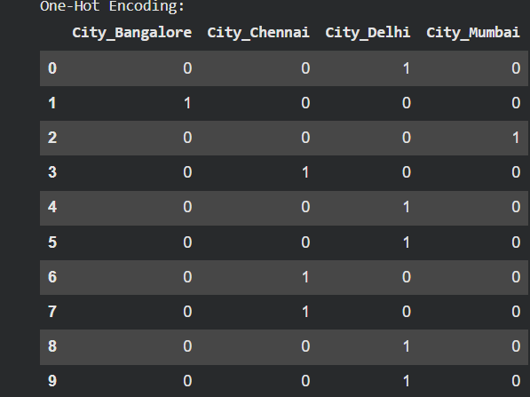
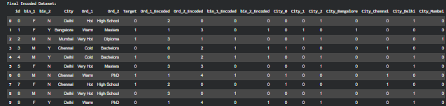
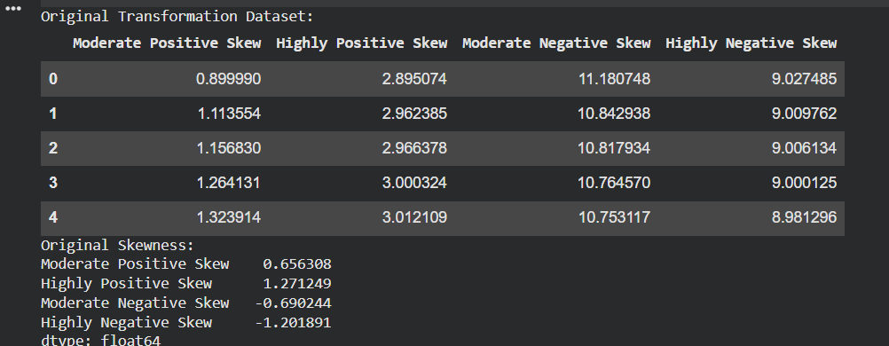
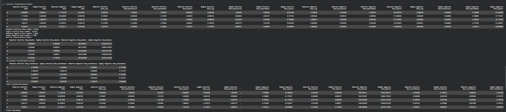
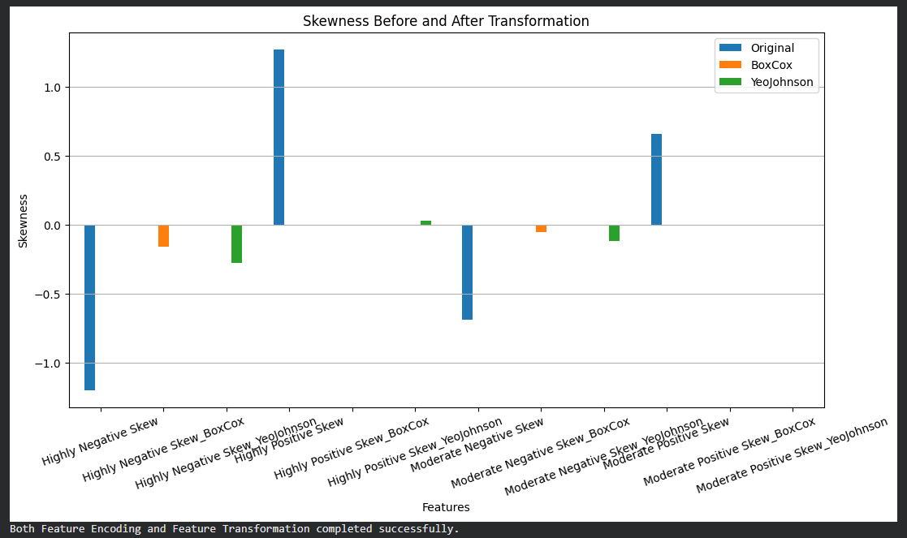
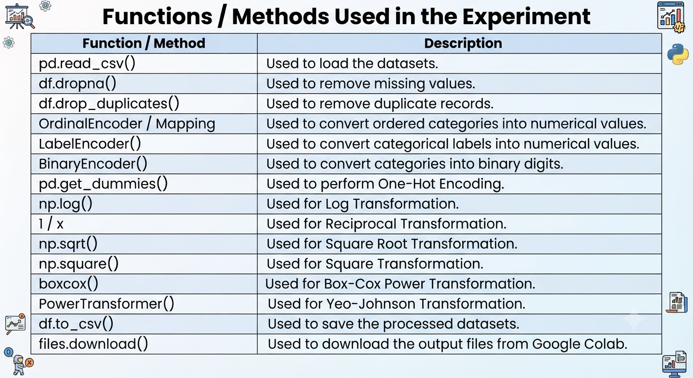

## EXNO-3-DS

# AIM:
To read the given data and perform Feature Encoding and Transformation process and save the data to a file.

# ALGORITHM:
STEP 1:Read the given Data.
STEP 2:Clean the Data Set using Data Cleaning Process.
STEP 3:Apply Feature Encoding for the feature in the data set.
STEP 4:Apply Feature Transformation for the feature in the data set.
STEP 5:Save the data to the file.

# FEATURE ENCODING:
1. Ordinal Encoding
An ordinal encoding involves mapping each unique label to an integer value. This type of encoding is really only appropriate if there is a known relationship between the categories. This relationship does exist for some of the variables in our dataset, and ideally, this should be harnessed when preparing the data.
2. Label Encoding
Label encoding is a simple and straight forward approach. This converts each value in a categorical column into a numerical value. Each value in a categorical column is called Label.
3. Binary Encoding
Binary encoding converts a category into binary digits. Each binary digit creates one feature column. If there are n unique categories, then binary encoding results in the only log(base 2)ⁿ features.
4. One Hot Encoding
We use this categorical data encoding technique when the features are nominal(do not have any order). In one hot encoding, for each level of a categorical feature, we create a new variable. Each category is mapped with a binary variable containing either 0 or 1. Here, 0 represents the absence, and 1 represents the presence of that category.

# Methods Used for Data Transformation:
  # 1. FUNCTION TRANSFORMATION
• Log Transformation
• Reciprocal Transformation
• Square Root Transformation
• Square Transformation
  # 2. POWER TRANSFORMATION
• Boxcox method
• Yeojohnson method

# CODING AND OUTPUT:

```

!pip install category_encoders -q

from google.colab import files
import pandas as pd
import numpy as np
import matplotlib.pyplot as plt
import category_encoders as ce

from sklearn.preprocessing import LabelEncoder, PowerTransformer
from scipy.stats import boxcox

uploaded = files.upload()

df = pd.read_csv("data.csv")

df = df.dropna().drop_duplicates()

print("Original Encoding Dataset:")
display(df)

ord1 = {
    'Cold': 0,
    'Warm': 1,
    'Hot': 2,
    'Very Hot': 3
}

ord2 = {
    'High School': 0,
    'Diploma': 1,
    'Bachelors': 2,
    'Masters': 3,
    'PhD': 4
}

df['Ord_1_Encoded'] = df['Ord_1'].map(ord1)
df['Ord_2_Encoded'] = df['Ord_2'].map(ord2)

le = LabelEncoder()
df['bin_1_Encoded'] = le.fit_transform(df['bin_1'])

df['bin_2_Encoded'] = df['bin_2'].map({'N': 0, 'Y': 1})

binary_encoder = ce.BinaryEncoder(cols=['City'])
binary_data = binary_encoder.fit_transform(df[['City']])

one_hot = pd.get_dummies(df['City'], prefix='City', dtype=int)

encoded_df = pd.concat([df, binary_data, one_hot], axis=1)

encoded_df.to_csv("Encoded_Data.csv", index=False)

print("Ordinal Encoding:")
display(df[['Ord_1', 'Ord_1_Encoded', 'Ord_2', 'Ord_2_Encoded']])

print("Label Encoding:")
display(df[['bin_1', 'bin_1_Encoded', 'bin_2', 'bin_2_Encoded']])

print("Binary Encoding:")
display(pd.concat([df[['City']], binary_data], axis=1))

print("One-Hot Encoding:")
display(one_hot)

print("Final Encoded Dataset:")
display(encoded_df)

files.download("Encoded_Data.csv")

data = pd.read_csv("Data_to_Transform.csv")

data = data.dropna().drop_duplicates()

print("Original Transformation Dataset:")
display(data.head())

print("Original Skewness:")
print(data.skew())

transformed_data = data.copy()

for col in data.columns:
    shifted = data[col] - data[col].min() + 1
    transformed_data[col + '_Log'] = np.log(shifted)
    transformed_data[col + '_Reciprocal'] = 1 / shifted
    transformed_data[col + '_SquareRoot'] = np.sqrt(shifted)
    transformed_data[col + '_Square'] = np.square(data[col])

print("Function Transformation Output:")
display(transformed_data.head())

boxcox_data = pd.DataFrame(index=data.index)

for col in data.columns:
    shifted = data[col] - data[col].min() + 1
    transformed, lam = boxcox(shifted)
    boxcox_data[col + '_BoxCox'] = transformed
    print(col, "Lambda:", round(lam, 4))

print("Box-Cox Transformation Output:")
display(boxcox_data.head())

yeo = PowerTransformer(method='yeo-johnson')

yeo_values = yeo.fit_transform(data)

yeo_data = pd.DataFrame(
    yeo_values,
    columns=[col + '_YeoJohnson' for col in data.columns],
    index=data.index
)

print("Yeo-Johnson Transformation Output:")
display(yeo_data.head())

final_data = pd.concat(
    [transformed_data, boxcox_data, yeo_data],
    axis=1
)

final_data.to_csv("Transformed_Data.csv", index=False)

print("Final Transformed Dataset:")
display(final_data.head())

print("Final Dataset Shape:", final_data.shape)

comparison = pd.DataFrame({
    'Original': data.skew(),
    'BoxCox': boxcox_data.skew(),
    'YeoJohnson': yeo_data.skew()
})

print("Skewness Comparison:")
display(comparison)

comparison.plot(kind='bar', figsize=(12, 6))
plt.title("Skewness Before and After Transformation")
plt.xlabel("Features")
plt.ylabel("Skewness")
plt.xticks(rotation=20)
plt.grid(axis='y')
plt.show()

files.download("Transformed_Data.csv")

print("Both Feature Encoding and Feature Transformation completed successfully.")
```




















# RESULT:

Thus, Feature Encoding techniques and Feature Transformation methods were successfully performed on the given datasets. The processed datasets were successfully saved as CSV files.

# SUMMARY:


In this experiment, I learned how to perform Feature Encoding and Feature Transformation using Python, Pandas, and Scikit-learn. The datasets were imported using pd.read_csv() and cleaned by identifying missing values and duplicate records.

Functions / Methods Used in the Experiment



Function Transformation techniques such as Log, Reciprocal, Square Root and Square transformations were applied to numerical features. These methods help modify the distribution of data.

Power Transformation techniques, including Box-Cox and Yeo-Johnson, were performed to reduce skewness and improve the distribution of numerical features.

Finally, the transformed datasets were saved using df.to_csv() and downloaded using Google Colab's files.download() function.

Libraries Used:
- Pandas: Data loading, cleaning, manipulation and saving datasets.
- NumPy: Mathematical operations and numerical transformations.
- Scikit-learn: Label Encoding and Yeo-Johnson Transformation.
- Category Encoders: Binary Encoding.
- SciPy: Box-Cox Transformation.
- Matplotlib: Visualization of skewness comparison.
- Google Colab Files: Uploading and downloading datasets.
